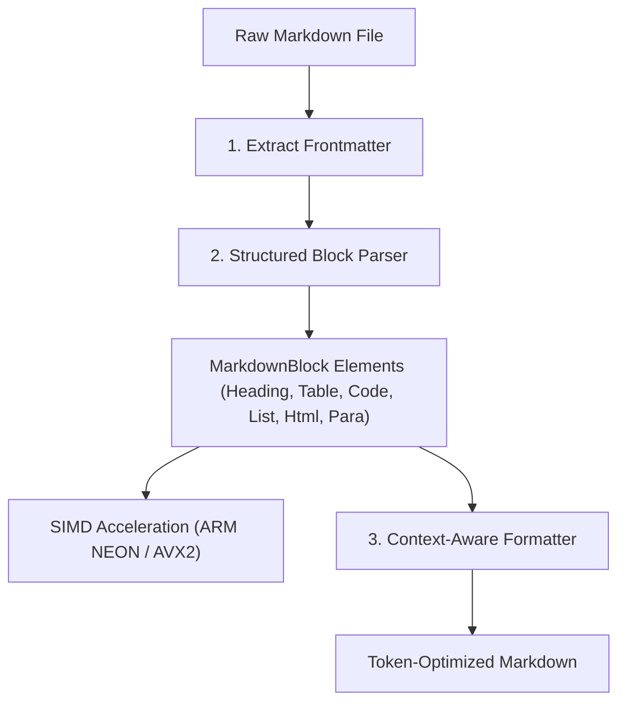

import { Steps } from '@astrojs/starlight/components';

`agent-md` is designed from the ground up for extreme performance, safety, and deterministic execution when embedded in AI agent workflows.

---

## Architectural Principles

1. **Zero External Runtime Parsers**: Rather than pulling in heavyweight generic Markdown AST crates (such as `pulldown-cmark`) or heavy serde JSON/YAML dependencies, `agent-md` implements focused, zero-dependency parsers for Markdown blocks, JSON, JSONC, and YAML.
2. **Parse-then-Format**: The engine separates document lexical analysis from string formatting.
3. **Hardware SIMD Acceleration**: Critical scanning operations (newline counting, whitespace identification, string search) utilize SIMD vectorization.
4. **Preserve What Matters**: Frontmatter, inline code spans, URLs, escaped characters, and meaningful indentation in nested code blocks are strictly preserved.

---

## The Parse-then-Format Pipeline



### 1. Frontmatter Extraction

The document header is inspected for YAML metadata (`--- ... ---`). If found, frontmatter is extracted and preserved verbatim without formatting mutations.

### 2. Block-Level Parsing (`src/parser.rs`)

The document is parsed into a sequence of strongly-typed `MarkdownBlock` variants:

- `Heading`: Retains heading level (1–6), clean text, raw slice, and 1-based line number.
- `CodeBlock`: Retains language identifier, code lines, indentation level, and fence type (` ``` ` or `~~~`).
- `Table`: Separates header row, divider row, and data rows.
- `List`: Tracks list marker type (`-`, `*`, `1.`), item indentation, and sub-blocks.
- `Html`: Recognizes raw HTML blocks and tags.
- `Paragraph`: Handles standard text content.

### 3. Context-Aware Formatting (`src/format/mod.rs`)

Each block is processed by specialized formatting submodules:

- `tables.rs` & `bold_tables.rs`: Trims cell padding, normalizes divider rows, removes bold markers inside cells while strictly preserving code spans.
- `code_blocks.rs`: Collapses spacing before `#` shell comments, normalizes folder branch markers (`├──` -> `├─`), strips spacer lines.
- `html.rs`: Minifies whitespace in HTML blocks while preserving line breaks in `<pre>`, `<code>`, `<script>`, and `<style>` blocks.
- `lines.rs`: Collapses redundant spaces between words, normalizes list indentation from 4 spaces to 2 spaces.

---

## Hardware SIMD Acceleration (`src/simd.rs`)

To ensure high-throughput execution across large codebases, `agent-md` includes cross-platform SIMD vectorization primitives:

- **ARM NEON**: Target-optimized for Apple Silicon (M1/M2/M3/M4) and ARM servers (AWS Graviton).
- **x86_64 AVX2 / SSE2**: Runtime feature detection with scalar fallbacks.

### Accelerated Hot Paths

- **Newline Counting**: Vectorized counting of `\n` characters across memory chunks to quickly resolve line numbers for diagnostics.
- **Consecutive Whitespace Scanning**: Fast detection of multi-space gaps during line compaction.
- **Delimiter Finding**: Accelerated scanning for table pipes (`|`), fence markers (`` ` ``), and comment hashes (`#`).
- **ASCII Case-Insensitive Search**: SIMD search scanning for fast `agent-md search` operations.

---

## Development & Testing

Run unit tests and verification suites locally:

```bash
# Run unit test suite
cargo test

# Check code formatting
cargo fmt --check

# Run Clippy lints
cargo clippy --all-targets --all-features -- -D warnings
```
